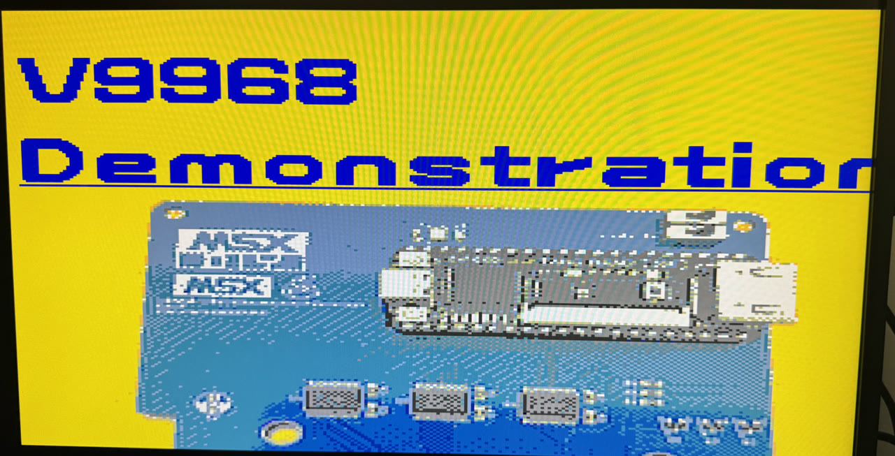
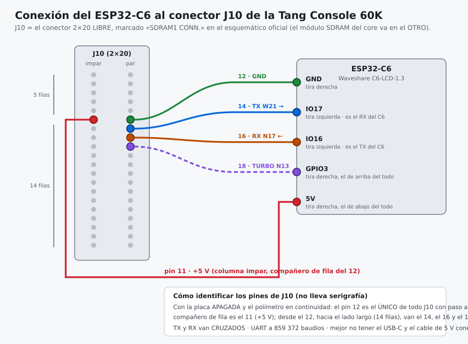
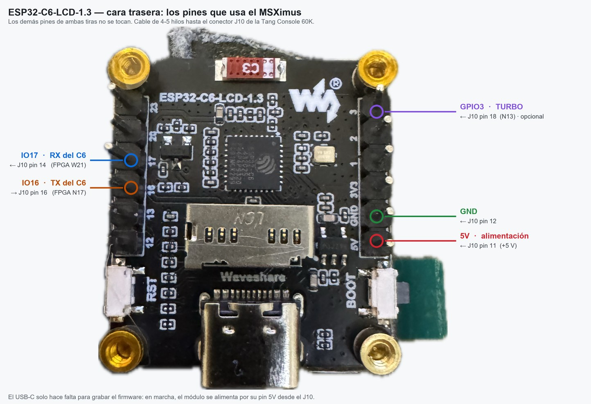
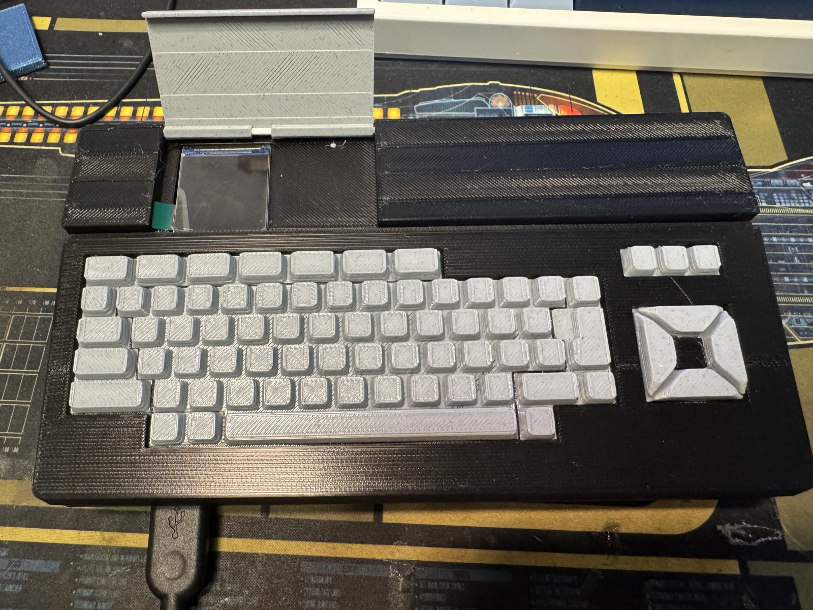
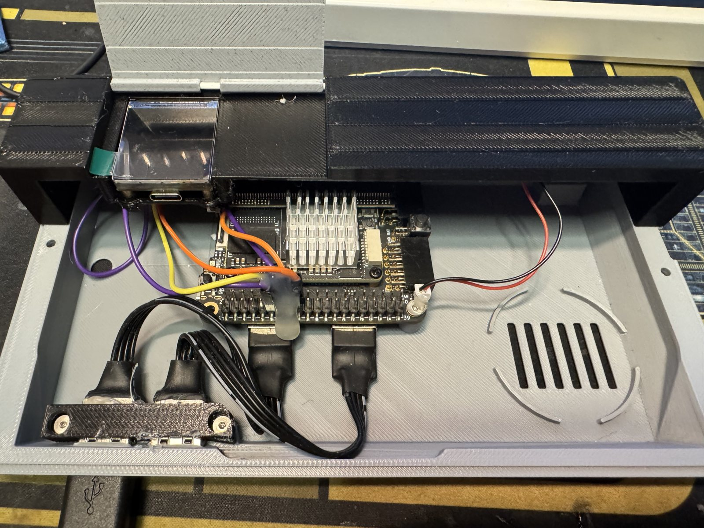
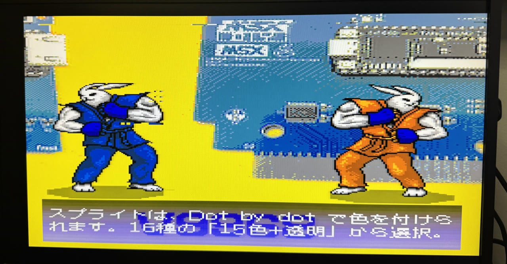

<p align="center"></p>

<h1 align="center">MSXimus</h1>
<p align="center"><b>A complete MSX2+ on a Tang Console 138K — now with the V9968 VDP</b></p>

> **This repository is the port of the MSXimus to the Tang Console 138K (MSXimus_138, v3.8.4).** What is specific to the port (SOM Mega 138K, flash map, PLL cascade, campaigns, what has and has not been tested) is in [README.138.md](README.138.md); the documentation adapted to the 138K is in [docs/INDICE.md](docs/INDICE.md) (both in Spanish). Installation, updates and the F12 panel are described here for the 138K; the rest is the MSXimus as it was born on the Tang Console 60K: same board, same core.
<p align="center">
  
  
  
</p>

<p align="center">🇪🇸 <a href="README.es.md">Versión en castellano</a></p>

<p align="center"></p>
<p align="center"><i>HRA!'s official V9968 demo, running on the MSXimus.</i></p>

---

**MSXimus** is the big brother of the [**MSXnano**](https://github.com/Papipapito/MSXnano): the same MSX2+ core lineage (goauld → MSXnano), ported to and expanded on the **Tang Console 60K**. *Nano* was the small one; *Maximus* is the big one.

It doesn't need an MSX. It **is** an MSX.

## Why v3.1 and not v2.2

Because the ground moved.

In August 2026 Gowin confirmed that the **SSRAM of the GW5AT-60B is withdrawn on purpose**: there is a silicon problem under investigation, and their recommendation is to migrate anything that uses it to BSRAM or to registers.

Version 2.1 leaned on that resource heavily — the audio engines alone accounted for most of it. So v3 is not v2.1 with more features stacked on top: it is the same MSX **rebuilt so that not one bit lives on the withdrawn resource**. Every memory that was there moved to BSRAM or to registers, and that meant reworking the OPL4 wavetable engine, the OPL3 register files and the PCM cache from the inside out.

That is a change at the foundation rather than on the surface, and it earned its own number. Everything you already knew works exactly the same; what changed is what it is standing on.

## What's inside

**Video** · Full-screen 720p HDMI output · **V9968** or V9958 · CRT-style borders · scanlines toggle, right from the menu

**Audio** · PSG · dual SCC with stereo · OPLL (MSX-Music) · **MSX-Audio Y8950** with FM and ADPCM-B · full **MoonSound / OPL4**: FM (OPL3) plus 24-voice wavetable

**Storage** · Nextor over microSD · 8 MB megaram with Konami4, Konami-SCC, ASCII8, ASCII16, NEO-8, NEO-16, ASCII16-X and Plain 0000h mappers

**Input** · USB keyboard straight into the board (no hub needed), with physical F1–F10 · USB gamepads mapped to MSX joysticks · USB mouse as an MSX mouse

**On screen** · Optional **status panel on F12**, in colour, painted over the MSX by the BL616 the board already carries

**Updates** · From the MSX itself, no PC: `MXUPDATE /N` downloads the latest version from the internet and flashes it; an `.UPD` file on the SD works too

**WiFi** · UNAPI through an external **ESP32-C6**, with an **optional display** for extra information

**Extras** · 5.37 MHz Panasonic-style turbo on **F11** · turboR-style machine identification · your choice of two BIOSes · boot logo · temperature-driven fan control · serial-port telemetry for diagnostics

## Required hardware

| | What | Notes |
|---|---|---|
| **Required** | [Sipeed **Tang Console 138K**](https://wiki.sipeed.com/hardware/en/tang/tang-console/mega-console.html) | Tang Mega 138K SOM (Gowin GW5AST-138), HDMI, 2× USB-A, microSD, DDR3 |
| **Required** | The Console's **SDRAM** module | It is the MSX's RAM; the core won't boot without it |
| Optional | **20×20 mm heatsink** on the SOM | Recommended: the core keeps the chip busy. [Like these](https://s.click.aliexpress.com/e/_c4WMlpD9) |
| Optional | **20×20 mm 5 V fan** | **1.25 mm JST connector, 2-pin** — [like this one](https://s.click.aliexpress.com/e/_c328rXwB). Fully temperature-controlled by the core |
| Optional | **USB** keyboard and gamepad | Straight into the board's USB-A ports, no hub |
| Optional | **USB mouse**, wired | Straight into the board. ⚠️ A **wireless** receiver will not work: it presents itself as a composite device |
| Optional | **ESP32-C6** (Waveshare C6-LCD-1.3) | For **WiFi**, with an optional info display |
| Optional | *Nothing to buy* — the board's own **BL616** | Enables the F12 status panel. Needs its firmware flashed once |

The fan is not needed for operation. If you fit one, the core drives it by itself: it measures the die temperature with an internal thermometer and only spins it when needed.

## Installation

Everything goes into the board's **SPI flash**, at three different addresses. ⚠️ **These are the 138K addresses**: the 138K bitstream is twice as big, so the pack and the OPL4 waves sit 1 MB higher than on the 60K (`0x400000` / `0x500000` there). The flash holds 8 MB, and the waves fill its last 2 MB.

| # | File | Address | Required? |
|---|---|---|---|
| 1 | `msximus138_v3.8.4_dado5569.fs` | **`0x000000`** | Yes — this is the core |
| 2 | BIOS pack (`pack_bios_msximus*.bin`) | **`0x500000`** | Yes — the MSX won't boot without it |
| 3 | `yrw801.bin` | **`0x600000`** | No — only for MoonSound/OPL4 (shipped as `.bin`: Gowin's Programmer does not accept `.rom`; rename a `yrw801.rom` if that is what you have) |

The rest of the release does not go into that flash:

| File | Where |
|---|---|
| `MXUPDATE.COM` | To the SD card: it updates the board from the MSX ([below](#updating-from-the-msx)) |
| `bl616_msximus_v3.8_138k.zip` | The BL616, for the F12 panel (optional) |
| `firmware_esp32c6_v3.8_merged.bin` | The ESP32-C6, for WiFi (optional) |

Each optional piece has its own section below.

**This is only needed once.** From v3.8.4 on, the next updates are done from the MSX itself: see [Updating from the MSX](#updating-from-the-msx).

**The tools you need**, all free and all official:

| For | Tool |
|---|---|
| The three files above | [**Gowin Programmer**](https://www.gowinsemi.com/en/support/download_eda/) (the one bundled with the 1.9.12 IDE works fine) |
| ESP32-C6 (WiFi) | [**esptool-js**](https://espressif.github.io/esptool-js/) in the browser — nothing to install — or `esptool` |
| BL616 (F12 panel) | [**Bouffalo Lab Dev Cube**](https://github.com/bouffalolab/bouffalo_sdk) (BLDevCube) |

### How to flash

1. Connect the board over **USB-C** and open the **Gowin Programmer** (the 1.9.12 one works fine).
2. Let it detect the device: it should report a **GW5AST-138**.
3. For **each** of the three files, configure a write operation to the **external SPI flash** (the options starting with *exFlash*, not the SRAM ones), select the file as *Programming File*, and put **the address from the table into the start-address field**. Use *exFlash Erase,Program,Verify* for the `.fs` and *exFlash C Bin Erase,Program* for the pack and `yrw801.bin`: with the first one the Programmer refuses a raw file with a "different id-code" error. If the address field has seven digits, the pack goes as `0x0500000` and the waves as `0x0600000`.
4. Flash the `.fs` first, then the other two. Their order doesn't matter — **the addresses do**: if the pack doesn't land exactly at `0x500000`, the core boots to a black screen.
5. **Power-cycle the board.** A reset is **not** enough: the DDR3 needs a cold recalibration and may hang after a warm reset.

> If you power up and only get a blue screen, it's almost always (a) the pack at the wrong address, or (b) a missing power-cycle.

### About the BIOS pack

The release ships **everything you need**: the core, the BIOS pack, the OPL4's `yrw801.bin` and the firmwares. Download, flash, and it boots.

There are **four builds of the same pack**: the menu in Spanish or in English, and the disk kernel inside:

| Pack | Menu | Nextor |
|---|---|---|
| `pack_bios_msximus.bin` | Spanish | **2.1.4** — the stable one |
| `pack_bios_msximus_en.bin` | English | **2.1.4** — the stable one |
| `pack_bios_msximus_nextor3.bin` | Spanish | **3.0 beta 2** — to try the beta |
| `pack_bios_msximus_en_nextor3.bin` | English | **3.0 beta 2** — to try the beta |

If you would rather build the pack from your own ROMs, there's the [**MSXnano Pack Builder**](https://github.com/Papipapito/MSXnano), which assembles the file from them, Nextor included.

Without `yrw801.bin` the core works just the same; you simply won't have MoonSound.

### One BIOS, and the menu is a setting

Up to v3.1 there were **two** packs and you had to decide which to flash. There is now **one**, and that choice is a tick box in Settings.

On power-up the machine **boots straight into the MSX**. If you want the SD browser: press **S** at boot, tick **"Menu al arrancar"**, then `Save & Restart`. Untick it and you are back to booting straight in. The choice is stored in the board's flash, so it survives a power cycle.

With the menu on you get the card browser, the ROM and DSK launcher and — if you fitted the WiFi — key **F** to search and download ROMs and disk images straight to the microSD, with no PC involved.

> Mounting a `.dsk` rewrites sectors of a file that **already exists**: it never creates directory entries or allocates clusters.

After that, insert a microSD with your ROMs and disk images and you're done. The best way to prepare it is **[MSX SD Maker](https://github.com/Papipapito/SD_Maker)**, which has its own repository (a copy with its guide is in [`MSXsdmaker/`](MSXsdmaker/README.md)): a Windows program that partitions the card the way Nextor does, installs Nextor and a set of programs (SofaRun, Multi Mente…) and writes the `AUTOEXEC.BAT`.

> **About microSD cards:** use a **name-brand, Class 10** card (Samsung, SanDisk, Kingston...), formatted **FAT16**. Cheap no-name cards read fine but reject or lose sector writes under sustained bursts — we measured it on the bench: a no-name card kept failing writes even when paced, while a Samsung EVO+ was flawless with the exact same code and geometry. If downloads or saves act up, suspect the card first.

## Updating from the MSX

From v3.8 the MSXimus updates **itself**: the core and the BIOS pack are written to the board's flash from the MSX, with no PC and no programmer. On the 138K the first v3.8 is v3.8.4, and it has to be flashed from the PC (it carries the *flash bridge* that lets the MSX write to that flash); after that, any of these three ways will do:

| Way | What it does | Needs |
|---|---|---|
| `MXUPDATE /N` | Downloads the latest 138K version from [msx.barcelona](https://msx.barcelona) and flashes it | MSX-DOS 2 or Nextor, and the ESP32-C6 (WiFi) |
| `MXUPDATE file.UPD` | Flashes a 138K `.UPD` file from the SD card | MSX-DOS 2 or Nextor |
| Settings → **Install update** | Flashes the `MSX138K.UPD` in the root of the SD card (the same name `MXUPDATE /N` saves it under) | Nothing else: no DOS needed |

**Fixes only come this way.** GitHub carries the big versions; the fixes are published only for `MXUPDATE /N`. Install the GitHub release once and `MXUPDATE /N` takes you to the latest.

`MXUPDATE.COM` is in the release and, on a card made with [MSX SD Maker](https://github.com/Papipapito/SD_Maker), in the `FPGA` folder (on the `PATH`). The 138K needs **version 1.3 or later**: 1.2 expected the 138K's pack at the old address and refuses its files without touching anything. The published MSX SD Maker release (1.4) carries 1.2: copy this release's `MXUPDATE.COM` over `FPGA\MXUPDATE.COM`, or just run `MXUPDATE /N`, which updates itself first. It recognises the board by itself, speaks the menu's language and **updates itself**: before looking for a new core on the internet it checks whether there is a newer MXUPDATE; if there is, it downloads it, checks it, replaces itself and carries on with the new one.

```
MXUPDATE                  flashes this board's file from the current directory (MSX138K.UPD on the
                          138K, MSXIMUS.UPD on the 60K, MSXNANO.UPD on the MSXnano); if it is not
                          there, it offers to download the latest version
MXUPDATE file.UPD         flashes that file
MXUPDATE /C file.UPD      only checks it (header and CRCs); the flash is not touched
MXUPDATE /N               downloads the latest version and flashes it
MXUPDATE /N /R            the full one (core, pack and the OPL4 waves) and back to factory settings
MXUPDATE /H   /?          help: the commands, without touching anything
```

With `/N` you pick the variant (Nextor 2.1.4 or 3, menu in Spanish or English), it downloads it to the SD card, checks it, asks, writes it and reads the whole flash back to check it again. Then: **switch off and on**. The connection is **TLS with the certificate validated** — with the v3.8 C6 firmware, which carries the certificate authorities; with an older one it still works, unvalidated, and says so.

Every file is checked **before anything is erased**, and the flash is read back afterwards. If something goes wrong, the MSX keeps running the previous core until it is switched off, so you can simply try again — and over the USB-C, with the Gowin Programmer, the board can always be reflashed: it cannot be bricked this way. The saved settings are kept (only `/R` erases them, on purpose).

Times, since the Z80 does all the work: pack only, 1.5 minutes. The 138K's core is twice the size of the 60K's, so core and pack take about 16 minutes and the full one about 22 (estimated from the 60K's measurements) — plus the download. Everything else is in the manual: [`docs/manual/11-actualizar.md`](docs/manual/11-actualizar.md) (Spanish).

## The status panel — F12 (optional)

The Console 138K carries, like the 60K, a second chip you have probably never used: a **BL616** microcontroller, wired to the FPGA from the factory. Give it a firmware and it will paint a status panel straight over the MSX picture.

Press **F12** and the MSX freezes and the panel comes up, in colour. Press it again (or ESC) and the game carries on exactly where it was. It is **read-only** — there is no menu, no cursor, nothing to break. It reports what the core says about itself, in the menu's language:

```
  MSXimus 138K                V3.8.4
  MSX
    Z80     3.58 MHz   normal
    Video   V9968 · HDMI 720p
  SD card
    SDHC    ready
  Settings
    Scanlines      Stereo
    Second SCC
  USB
    Port 1  keyboard    Port 2  gamepad
  System
    Fan             stopped
    Caps lock       no
  Update: MXUPDATE /N
  [F12] Back to the MSX
```

This costs you nothing in hardware: **no wires, no soldering, no module**. The link between the two chips (a 2 Mbps serial line) was already routed on the board; it was just never used.

> Because the BL616 takes F12 for itself, that key never reaches the MSX. The **turbo toggle is F11**.

### Flashing the BL616

The release ships it in a ZIP, **`bl616_msximus_v3.8_138k.zip`**: the MSXimus image, which goes at **`0x40000`**, and the `.ini` that writes it. The Sipeed firmware the Console 138K carries at `0x0` is not touched: the two **coexist**.

1. **Hold the BOOT button down while you plug in the USB.** That puts the chip in ISP mode.
2. A **new COM port** appears — that one is the BL616. (Listing the ports before and after plugging it in is the easy way to tell which.)
3. Unzip it into a folder, open **BLDevCube** and load its **`flash_prog_cfg.ini`**: it already carries the image and its address, so there is nothing to type.
4. Unplug the PC's USB and power the board from a **USB charger**.

> The panel only works with the board powered from a charger: with the PC's USB plugged in, the BL616 acts as the JTAG bridge for the Gowin Programmer and there is no panel.

ISP mode lives in the chip's ROM, not in its flash, so it works no matter what you have written. **It is the reverse gear that never fails** — you cannot brick the board this way.

If you would rather not flash it at all, don't: the MSX works exactly the same, you simply won't have the F12 panel.

## Wiring the ESP32-C6 (WiFi)

Optional — the core works fine without it; you simply won't have WiFi. Three or four wires between the board's **J10** header and the module:

<p align="center"></p>

| J10 pin | Signal | FPGA ball | ESP32-C6 |
|---|---|---|---|
| **11** | +5 V (power) | — | **5V** (right strip, last one) |
| **12** | GND | — | **GND** (right strip) |
| **14** | TX (FPGA → C6) | W21 | **IO17** (left strip, the C6's RX) |
| **16** | RX (FPGA ← C6) | N17 | **IO16** (left strip, the C6's TX) |
| **18** | TURBO (FPGA → C6) | N13 | **GPIO3** (right strip, first one) — optional, only feeds the display's turbo indicator |

And this is the module side:

<p align="center"></p>

- **J10 is the free 2×20 header**, labelled *SDRAM1 CONN.* in Sipeed's schematic — **not** the one holding the SDRAM module the core needs.
- **Identifying the pins without silkscreen**: with the board powered off and a multimeter in continuity mode, **pin 12 is the only pin on the whole header with a path to ground**. Its row partner is pin 11 (+5 V), and from pin 12 towards the long side (the one leaving 14 rows, not 5) come 14, 16 and 18.
- **Power comes from J10 itself** (pin 11 → the module's `5V`): the C6's USB-C is only needed to flash its firmware.
- ⚠️ **Better not to have both power sources connected at once.** The module has protection and copes fine, but when flashing over USB-C it's advisable to unplug the 5 V wire (or power the board down).
- TX and RX are **crossed**, as usual. The UART runs at 859 372 baud.
- ⚠️ If a second SDRAM module is ever fitted on J10, the ESP has to move elsewhere.

### Flashing the C6

The module's firmware and its full technical inventory live in their own repository, [**ESP32-for-FPGA**](https://github.com/Papipapito/ESP32-for-FPGA) — the same binary serves the MSXimus and the MSXnano, so no copy is kept here any more. Take `firmware_esp32c6_v3.8_merged.bin` from the release and write it to the C6 through **its own USB-C**. The v3.8 build carries the certificate authorities that `MXUPDATE /N` uses to validate msx.barcelona's certificate (they last until 2046: no need to reflash it when the site renews its certificate). You do **not** need the Arduino IDE, and you do not need to compile anything — the release ships a single merged binary.

**The easy way — from the browser, nothing installed.** Open [**esptool-js**](https://espressif.github.io/esptool-js/), Espressif's own web flasher, in Chrome or Edge. Connect, pick the file, set the offset to `0x0`, and click Program. No drivers, no Python, no IDE.

**The command-line way**, if you already have it:

```
esptool --chip esp32c6 --port COMx write_flash 0x0 firmware_esp32c6_v3.8_merged.bin
```

> There is no drag-and-drop route like the Raspberry Pi Pico's `.uf2`: the ESP32 has no mass-storage bootloader in ROM, so a file you copy onto a drive is not an option on any ESP32. The web flasher above is as close as it gets — one page, two clicks, nothing to install.

## The case

A 3D-printable case in the shape of a Spectravideo SVI-728, with the Console 60K inside, a bay with a lid for the ESP32-C6 and its display, a fan, and the connectors brought out to the back and the front. It derives from Palver's [SVI-728 Retropie case](https://www.thingiverse.com/thing:4066021).

<p align="center"></p>
<p align="center"></p>

The Bambu Studio project, the STLs, the print settings and the assembly notes are in [`carcasa/`](carcasa/README.md).

## Status

**v3.8.4 (17/10/2026) is the first v3.8 for the Console 138K.** Its RTL is that of the 60K's v3.8.4, validated on a 60K on 16/10/2026, plus what is the 138K's own (clocks, flash map, timing). **It has not been validated on a 138K yet**: what has and has not been tried is in [README.138.md](README.138.md). On the 60K, the v3.7 base was validated with HRA!'s V9968 test suite, the DEVCON demos, Metal Gear 2, Aleste 2 and the usual MSX2+ catalogue. The V9968 tracks HRA!'s **latest published revision**; its provenance and every local patch are documented in [`fpga/v9968/ORIGEN.txt`](fpga/v9968/ORIGEN.txt).

## Repository layout

```
carcasa/         The 3D-printable case (3MF, STLs, assembly)
docs/            Manual, technical reference, history, logo, photos
MSXsdmaker/      MSX SD Maker: prepares the SD card (Windows program + instructions)
fpga/            top.v, build.tcl
  v9968/         The V9968 VDP (+ ORIGEN.txt: provenance and local patches)
  video720/      HDMI bridge and scaler
  src/           Own RTL (VRAM shim, DDR3 backend, audio, USB, S1990…)
    iosys/       The BL616 link and the on-screen panel
  constraints/   Console 138K (and 60K) pinout and constraints
  pll138/        The PLL + PLL_INIT cascade of the GW5AST
tools/           Testbenches and validation utilities
  mxupdate/      MXUPDATE.COM (MSXgl + UNAPI)
  mxupd.py       Builds the .UPD files and the update manifest
```

## What's new in v3.8.4

The first v3.8 for the Console 138K. The core changes and so does the pack: **flash both, once, from the PC**, at the 138K's addresses — after that, updates come from the MSX.

- **Updating from the MSX.** A *flash bridge* in the core (switched-I/O device 4Dh) lets the MSX read, erase and program the board's flash. `MXUPDATE.COM` 1.3 uses it: an `.UPD` file from the SD card, or straight from the internet with `/N` (msx.barcelona, TLS with the certificate validated); `/R` does a full update (core, pack and OPL4 waves) and goes back to factory settings. **Settings → Install update** does the same with no DOS at all. Everything is checked before anything is erased, and read back afterwards. See [Updating from the MSX](#updating-from-the-msx).
- **The F12 panel in colour**, now on the 138K too, with the BL616 firmware built for it: Z80 and turbo, video, SD card, the main settings, what is on each USB-A port, fan, caps lock and the update command, in the menu's language. ESC closes it too.
- **The OPL4 as the real chip** (what the 60K got as network updates 3.8.1 to 3.8.4): wavetable registers read back right the first time, `F8h` starts at 1Bh, FM vibrato and tremolo as on the YMF262, NEW2 also through port `C5h` (the MoonBlaster Wave BASIC-driver music disks were silent), headroom for the 24 wave voices, fades without buzzing, envelope and attack as on the YMF278B, panning in −3 dB steps, DAMP and pseudo-reverb, and no burst of noise in *Dutch Moonsound Veterans*. Wave sits 3 dB per channel lower than before (openMSX's level); channel 6 of the Settings mixer is already at 8/8, so to give it more weight, lower the other channels.
- **The mapper from the ROM's own signature** ([MSXgl's convention](https://aoineko.org/msxgl/index.php?title=ROM_type_signature)): geo3d's ROMs and anything made with MSXgl launch with the right mapper, no `[ASCII16]` in the name needed.
- **The 60K's v3.7.1 to v3.7.6**: the sorted SD browser, ASCII16-X and an 8 MB megaram, HRA!'s V9968 fixes (port 99h, DIY copies, sprites at the left border) and the boot stripes in our VRAM shim, generic USB gamepads without the phantom LEFT, packs in English, and Settings showing the version with three digits (`3.8.4`).
- **The ESP32-C6 firmware carries certificate authorities** (16 of Mozilla's), so the board validates the update server's certificate.
- **The 138K's own**: the flash map of v3.7-8mb, which fits the board's 8 MB flash (a W25Q64, the same as the 60K's): pack at `0x500000`, settings at `0x580000`, OPL4 waves at `0x600000`. And the CPU's write data to the SDRAM is registered at 54 MHz before crossing to 108 MHz: it was the worst timing path of the 138K seeds rejected since October.
- **Documentation**: two new chapters, [`docs/manual/11-actualizar.md`](docs/manual/11-actualizar.md) (how to update) and [`docs/tecnica/11-actualizacion.md`](docs/tecnica/11-actualizacion.md) (the flash bridge, the `.UPD` format, the manifest), in Spanish.

## What's new in v3.2

The core **does not change**: it is the same `.fs` as v3.1. What changes is everything above it.

- **One BIOS** — no more picking a pack. The SD browser is now a tick box in Settings: `S` at boot, "Menu al arrancar", done. Stored in flash.
- **Downloads from the menu** — with WiFi, key `F` searches and pulls ROMs and disk images straight to the microSD, no PC.
- **Boot logo on the C6 screen** — the MSX logo assembling from both sides, like a real MSX2.
- **The C6 firmware lives in its own repository**, [ESP32-for-FPGA](https://github.com/Papipapito/ESP32-for-FPGA), and it is the same binary for the MSXimus and the MSXnano.

## What's new in v3.1

- **Rebuilt off the withdrawn silicon** — the whole core now runs without the GW5AT-60B's SSRAM. This is the headline of the version and the reason for the number; the [why](#why-v31-and-not-v22) is at the top.
- **A status panel on F12** — the BL616 already on the board paints the machine's real state over the picture, with the MSX frozen underneath. No wires, no module, no extra hardware.
- **It introduces itself as a turboR** — the S1990 identification registers are in (`E4h`–`E7h`), and `CHGCPU` really does move the turbo. No R800: same Z80, telling the truth about what it is.
- **MSX mouse from a USB mouse** — plug a **wired** USB mouse into the board and MSX software sees an MSX mouse. (A wireless receiver will not do: it presents itself as a composite device.)
- **Two BIOSes to choose from** — a plain MSX, or the same plus an SD browser and launcher. *(Merged into one in v3.2.)*
- **Turbo on F11** — F12 now belongs to the panel.

Everything from v2.1 is still here: the V9968 at HRA!'s latest revision, the remastered audio, the 256 KB MSX-Audio, the CRT-style picture and the full 2 MB ASCII16 megaROMs.

## The V9968

The heart of the MSXimus is **Takayuki Hara's (HRA!) [V9968](https://github.com/hra1129/V9968_Cartridge)**, an imaginary VDP that extends the V9958 with everything Yamaha never got to ship:

- **Multicolor sprites**: 15 colors plus transparency **per sprite**, defined pixel by pixel
- **16 sprites per line** instead of 8 — flicker is over
- **Scalable sprites**, with free magnification, rotation and mirroring
- **Extended palette**: 256 colors in 16 sets of 16
- **256 KB of VRAM**, extended commands (LRMM rotation, LFMM, LFMC) and a fast command mode

<p align="center"></p>
<p align="center"><i>15-color sprites defined pixel by pixel: impossible on a real MSX2+.</i></p>

The V9968's VRAM lives in the board's **DDR3**, leaving the whole SDRAM to the MSX's RAM and to whatever comes next.

And it's still a regular MSX2+: your usual software runs just the same.

## License

**GPLv3**, derived from [`Papipapito/MSXnano`](https://github.com/Papipapito/MSXnano). See [LICENSE](LICENSE) and [UPSTREAM.md](UPSTREAM.md) for full attribution and third-party IP.

The **V9968** belongs to Takayuki Hara and comes under his own BSD-like but **non-commercial** license: it may be redistributed with its notices intact and published for free, **but not sold**. That condition is inherited, so **this project is not for sale**.

The MSXimus logo belongs to the project.

---

# Thanks

I didn't build this alone — not even close. Everything here stands on the work of people who published theirs so others could keep going.

### The core and its lineage

- **[jabadiagm](https://github.com/jabadiagm)** — MSXgoauldSD, the Goa'uld, origin of this whole lineage (goauld → MSXnano → MSXimus), and MSX_LCD_tn20k.
- **OCM-PLD / ESE Artists' Factory lineage** — Kunihiko Ohnaka, KdL and everyone who has kept the FPGA MSX2+ alive for two decades. The V9958 VDP comes from there.

### The V9968

- **[Takayuki Hara — HRA!](https://github.com/hra1129)** — author of the **V9968**, the VDP that makes this version special, of the DEVCON demo and of the whole test suite it was validated against. Thank you for publishing and documenting it so well.
- **[Albert Herranz — herraa1](https://github.com/herraa1)** — the MSXgl demo port (`ru66-v9968-demo`), the V9968 cartridge and the reference material that made debugging the core possible.

### Audio

- **[Jose Tejada — jotego](https://github.com/jotego)** — jt2413 (OPLL), jtopl2 (Y8950 FM) and jt10_adpcmb. GPLv3.
- **[Greg Taylor — gtaylormb](https://github.com/gtaylormb)** — opl3_fpga (LGPLv3), which includes `afifo.v` by **Dan Gisselquist (ZipCPU)**.
- **Jokin Miragaia (antxiko)** — mangOPL4, the Gowin fixes and the integration lessons.
- **srg320** — YMF278B.sv, the OPL4's PCM engine, contributed with express permission.
- **MAME team** — R. Belmont, Olivier Galibert and hap (ymf278b.cpp), and **Aaron Giles** (ymfm).
- **Tatsuyuki Satoh** — the reference ADPCM-B algorithm.

### The board and the video chain

- **[nand2mario](https://github.com/nand2mario)** — `ddr3_framebuffer_gowin` (the DDR3 IP recipe that makes VRAM-in-DDR3 possible), `usb_hid_host`, the 720p video template and, in general, for clearing the path in the Tang ecosystem.
- **hdl-util (Sameer Puri)** — the HDMI packer (MIT).
- **[ducasp](https://github.com/ducasp)** — the ESP UNAPI firmware and protocol.

### Validation and tools

- **The [openMSX](https://openmsx.org) team** — the reference against which right and wrong get decided.
- **Laurens Holst (grauw)** — VGMPlay MSX and the MSX Assembly Page.
- **aoineko (Guillaume Blanchard)** — MSXgl.
- **[Sipeed](https://sipeed.com)** and **Gowin** — the board and the toolchain.
- **Yamaha** — for the original chips (V9958, YM2149, YM2413, Y8950, YMF262, YMF278B) that this project emulates with love.

### And

- **Claude (Anthropic)** — **code co-author**: new RTL, the VRAM-over-DDR3 shim, the audio integrations, the validation suite, and an indecent number of debugging hours built on simulation, telemetry, and being wrong many times before being right.

---

<p align="center"><i>For the MSX community. May it last another forty years.</i></p>
