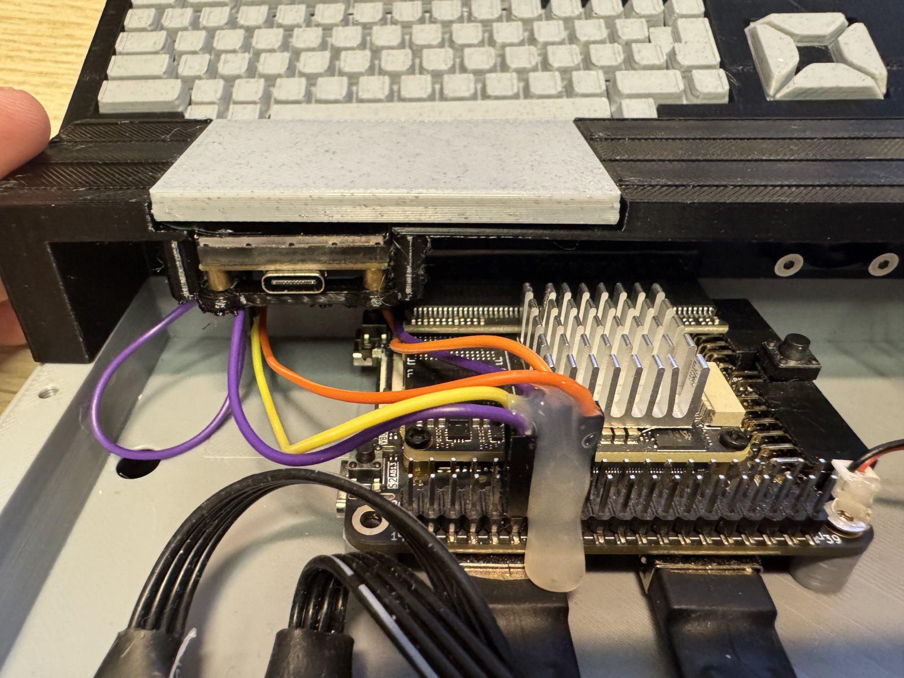
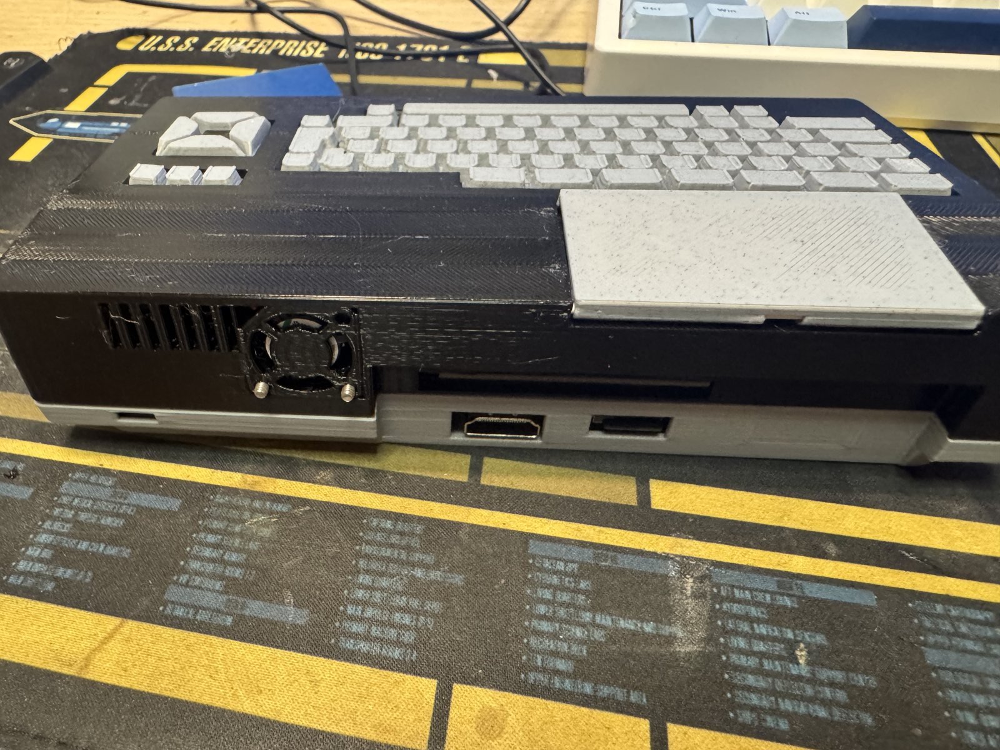

# 02. Instalación

Qué hay que grabar en la placa y con qué herramienta. Todo lo obligatorio va a la flash de la propia placa por el USB-C; las dos piezas opcionales, el ESP32-C6 y el BL616, tienen su propio procedimiento.

> **Aviso.** El MSXimus_138 es el porte del MSXimus a la Tang Console 138K: la misma placa base con el SOM Tang Mega 138K en vez del Mega 60K. Ninguna versión del 138, tampoco la v3.8.4, se ha validado todavía en una placa 138K: el core está compilado y verificado en simulación, pendiente de placa (la v3.8.4 del 60K, con el mismo RTL, sí está validada). Lo que este capítulo cuenta como procedimiento es el del 60K trasladado al mapa de flash del 138; lo que se ve al encender (logo, menú, calibración de la DDR3) está pendiente de verificar en placa.

## 1. Lo que va a la flash de la placa

Tres ficheros, cada uno a una dirección distinta de la misma flash SPI de 8 MB (una W25Q64, la misma que en el 60K):

| Fichero | Dirección | Obligatorio |
|---|---|---|
| El core: `msximus138_v3.8.4_dado5569.fs` en la release (en las entregas de `files/<fecha>/` se llama `msximus138_v3.x_dadoNNNN.fs`) | **0x000000** | Sí |
| El pack de BIOS, `pack_bios_msximus*.bin` | **0x500000** | Sí, sin él la máquina no arranca |
| `yrw801.bin`, la ROM de ondas del MoonSound (va como `.bin` porque el Programmer de Gowin no coge `.rom`; si tienes un `yrw801.rom`, renómbralo) | **0x600000** | No, solo para tener el OPL4 completo |

Las direcciones **no son las del 60K** (allí el pack va en 0x400000 y el `yrw801.bin` en 0x500000): el bitstream del 138K ocupa unos 4,9 MB (5.096.124 bytes), el doble que el del 60K, y se comería un pack grabado en 0x400000. Por eso todo lo que va detrás del core está 1 MB más arriba. El `yrw801.bin` es el mismo fichero. Los packs publicados para el 60K también arrancan en la 138K grabados en 0x500000, pero para *Instalar actualización* hacen falta los de esta release (bios `30f1ce2`): los del 60K (hasta su v3.8.4) buscan `MSXIMUS.UPD` y esperan el pack de la 138K en 0x800000.

**Esto solo hace falta una vez.** Desde la v3.8.4, las siguientes versiones se graban desde el propio MSX (sección 5 y [capítulo 11](11-actualizar.md)).

La release de la v3.8.4 trae:

| Fichero | Para qué |
|---|---|
| `msximus138_v3.8.4_dado5569.fs` | El core, en 0x000000 |
| `pack_bios_msximus.bin` (menú en castellano), `_en` (inglés), `_nextor3` y `_en_nextor3` (Nextor 3.0 beta 2) | El pack, en 0x500000: uno de los cuatro |
| `yrw801.bin` | Las ondas del OPL4, en 0x600000 |
| `MXUPDATE.COM` (1.3) | A la SD: actualizar desde el MSX ([capítulo 11](11-actualizar.md)) |
| `bl616_msximus_v3.8_138k.zip` | El panel F12, en el BL616 (sección 2) |
| `firmware_esp32c6_v3.8_merged.bin` | La WiFi, en el ESP32-C6 (sección 3) |

No lleva imagen de tarjeta: la SD se prepara con [MSX SD Maker](https://github.com/Papipapito/SD_Maker) ([capítulo 03](03-tarjeta-sd.md)). Con `yrw801.bin` sin grabar todo funciona igual, salvo la tabla de ondas del MoonSound.

**Herramienta**: el [Gowin Programmer](https://www.gowinsemi.com/en/support/download_eda/), el que viene con el IDE 1.9.12. Ya se ha usado con una 138K: el 16 de octubre de 2026 grabó en una el `.fs` de la v3.7 e identificó su flash (`0xEF4017`, la W25Q64 de 8 MB). Para compilar el core, en cambio, hace falta la edición Standard 1.9.12.03 con licencia: la Education no soporta el GW5AST-138.

### Cómo grabar

1. Conecta la placa por USB-C y abre el Gowin Programmer.
2. Deja que detecte el dispositivo: debe decir **GW5AST-138**.
3. Para cada uno de los tres ficheros, configura una operación de escritura en la **flash SPI externa** (las opciones que empiezan por *exFlash*, no las de SRAM), elige el fichero como *Programming File* y escribe **la dirección de la tabla** en el campo de dirección de inicio.
4. Graba primero el core y luego los otros dos. El orden no importa; **las direcciones sí**: si el pack no cae exactamente en 0x500000, la máquina arranca a pantalla negra. En el Gowin Programmer, el `.fs` va con *exFlash Erase,Program,Verify* y el pack y la ROM de ondas con *exFlash C Bin Erase,Program*, la segunda con la extensión cambiada a `.bin` (con un `.rom`, o con la primera operación, el programador da un error de "id-code"). Si el campo de dirección tiene siete cifras, se escribe `0x0500000` y `0x0600000`. Si el programador avisa de que el fichero no cabe en la flash ("exceeding the limit"), no ha grabado nada: la dirección está mal.
5. **Apaga y enciende la placa.** Un reset no basta: la DDR3 necesita calibrar en frío y, en el 60K, puede quedarse colgada tras un reset en caliente (en el 138, misma IP y mismo motor de reintentos, pendiente de verificar en placa).

Si al encender solo hay una pantalla azul, es casi siempre el pack en una dirección equivocada o que falta el apagado y encendido.

Para el Gowin Programmer vale el `.fs`, el único que trae la release. Las entregas de `files/<fecha>/` traen además un `_jtag.bin`: el mismo bitstream en binario, que es lo que llevan los `.UPD` en 0x000000. Con el Programmer se usa el `.fs`.

El nombre del dispositivo en las entregas dice con qué versión del chip se compiló el core: **GW5AST-138B** o **GW5AST-138C**. Sipeed monta chips versión C desde julio de 2025; la serigrafía del chip del SOM dice cuál lleva cada placa.

### El pack de BIOS

Hay cuatro packs iguales en todo salvo el idioma del menú y el kernel de disco que llevan dentro:

| Pack | Menú | Nextor |
|---|---|---|
| `pack_bios_msximus.bin` | castellano | **2.1.4**, el estable, el que quieres |
| `pack_bios_msximus_en.bin` | inglés | **2.1.4** |
| `pack_bios_msximus_nextor3.bin` | castellano | **3.0 beta 2**, para probar la beta |
| `pack_bios_msximus_en_nextor3.bin` | inglés | **3.0 beta 2** |

Los cuatro llevan la BIOS y la SubROM internacionales. Quien prefiera montar el pack con sus propias ROMs tiene el [Pack Builder del MSXnano](https://github.com/Papipapito/MSXnano), que las ensambla con Nextor incluido. El [capítulo 04 de la referencia técnica](../tecnica/04-pack-bios.md) describe qué lleva y en qué orden.

Un mismo pack sirve para cualquier core del 138 (y para los del 60K desde la versión 3.5c): el menú y el driver de disco sondean el core y usan lo que tenga. Con la v3.8.4 van los de su release: los packs anteriores no instalan los `.UPD` de la 138K desde Ajustes (*Instalar actualización* no existe o espera el pack de la 138K en 0x800000).

### Después de grabar

En una placa recién grabada la máquina arranca en el navegador de la tarjeta. Quien prefiera que arranque directamente en el MSX, como un ordenador de siempre: **S** durante el logo, desmarcar **Menú al arrancar** y **Save & Restart**. Es un ajuste guardado en la flash, sobrevive a los apagados, y se vuelve a activar marcándolo. El [capítulo 04](04-menu.md) cuenta el menú entero.

Con eso, una microSD con ROMs y discos, y ya está. El [capítulo 03](03-tarjeta-sd.md) explica cómo prepararla; la forma más fácil es [MSX SD Maker](https://github.com/Papipapito/SD_Maker).

Copia también a la SD el `MXUPDATE.COM` de la release: con él, las siguientes versiones se instalan desde el MSX ([capítulo 11](11-actualizar.md)). Una tarjeta hecha con MSX SD Maker ya lo lleva en la carpeta `FPGA`, en el `PATH`, pero la 138K necesita la 1.3 o posterior y la release publicada de SD Maker (la 1.4) trae la 1.2: copia el de esta release encima de `FPGA\MXUPDATE.COM`, o lanza `MXUPDATE /N`, que antes de nada se pone al día solo.

## 2. El panel F12: el BL616 (opcional)

La Console 138K lleva, como la 60K, un microcontrolador **BL616** cableado a la FPGA de fábrica. Con un firmware, dibuja un panel de estado en color sobre la imagen del MSX cuando se pulsa **F12**: versión del core, CPU y turbo, vídeo, tarjeta, los ajustes principales (scanlines, estéreo, segundo SCC), qué hay en cada USB-A, ventilador y bloqueo de mayúsculas, y la orden para actualizar (`MXUPDATE /N`). En la cabecera dice `MSXimus 138K`. Con F12 otra vez (o ESC), el juego sigue donde estaba. Es de solo lectura: no hay menú ni cursor. Habla el idioma del menú.

No cuesta nada en hardware: la línea serie entre los dos chips ya está en la placa. Sin el firmware, el MSX funciona igual; solo falta el panel. Como el BL616 se queda la tecla F12, el turbo va en **F11**.

En la release va en un ZIP, `bl616_msximus_v3.8_138k.zip`: la imagen del panel, que va en **0x40000**, y el `flash_prog_cfg.ini` que la graba. El *partner firmware* de Sipeed que la Console 138K trae en 0x0 no se toca: los dos conviven.

1. **Mantén pulsado el botón BOOT mientras conectas el USB.** Eso pone el chip en modo ISP.
2. Aparece un **puerto COM nuevo**: ese es el BL616. Listar los puertos antes y después de conectar es la forma fácil de saber cuál.
3. Descomprime el ZIP en una carpeta, abre **BLDevCube** (el [Bouffalo Lab Dev Cube](https://github.com/bouffalolab/bouffalo_sdk)) y carga su `flash_prog_cfg.ini`: ya lleva la imagen con su dirección.
4. Desconecta el USB del PC y alimenta la placa con un **cargador USB**. El panel solo funciona así: con el USB del PC enchufado, el BL616 hace de puente JTAG para el Gowin Programmer y no hay panel.

El modo ISP vive en la ROM del chip, no en su flash, así que funciona escriba lo que se escriba: no se puede dejar la placa inservible por aquí.

Es el firmware del 60K compilado para la Console 138K; en una placa 138K está pendiente de verificar.

## 3. La WiFi: el ESP32-C6 (opcional)

Sin él el core funciona igual; solo falta la red. El módulo es la Waveshare **ESP32-C6-LCD-1.3**, que además de la WiFi trae una pantalla de 240×240 donde se ve el estado.

### Cableado

Cuatro cables, o cinco con el indicador de turbo, entre el conector **J10** de la placa y el módulo. La placa base es la misma que la de la Console 60K, así que el conector y los pines son los mismos; los pines `esp_*` del SOM 138K son copia bola a bola de los del 60K, sin contrastar todavía contra el esquemático (pendiente de verificar en placa):

| Pin J10 | Señal | Lado del C6 |
|---|---|---|
| **11** | +5 V | **5V**, tira derecha, el último |
| **12** | GND | **GND**, tira derecha |
| **14** | TX, FPGA → C6 | **IO17**, tira izquierda |
| **16** | RX, FPGA ← C6 | **IO16**, tira izquierda |
| **18** | Turbo, FPGA → C6 | **GPIO3**, tira derecha, el primero. Opcional: solo alimenta el indicador de la pantalla |

- **J10 es el conector 2×20 libre**, el que Sipeed llama *SDRAM1 CONN.* en el esquema. No es el que lleva el módulo SDRAM del core.
- **Sin serigrafía**: con la placa apagada y un polímetro en continuidad, **el pin 12 es el único de todo el conector con camino a masa**. Su compañero de fila es el 11, y desde el 12 hacia el lado largo del conector, el que deja catorce filas y no cinco, vienen el 14, el 16 y el 18. Un cable plano de una hilera en esa columna resuelve todo.
- La alimentación sale del propio J10. El USB-C del módulo solo hace falta para grabar su firmware.
- **Mejor no tener las dos alimentaciones a la vez.** El módulo tiene protección, pero al grabar por USB-C conviene soltar el cable de 5 V o apagar la placa.
- TX y RX van cruzados. La línea va a 859372 baudios.
- Si algún día se pincha un segundo módulo SDRAM en J10, el ESP tiene que mudarse.

### El firmware del C6

Vive en su propio repositorio, [ESP32-for-FPGA](https://github.com/Papipapito/ESP32-for-FPGA); el mismo binario sirve para el MSXimus del 60K, para el del 138K y para el MSXnano. La release trae el binario fusionado, `firmware_esp32c6_v3.8_merged.bin`, que se graba por el **USB-C del módulo**, sin Arduino y sin compilar nada. El de la v3.8 lleva de serie las autoridades de certificación con las que `MXUPDATE /N` valida el certificado de msx.barcelona ([capítulo 11](11-actualizar.md)):

- **Desde el navegador**, sin instalar nada: [esptool-js](https://espressif.github.io/esptool-js/), el flasheador web de Espressif, en Chrome o Edge. Conectar, elegir el fichero, dirección 0x0, Program.
- **Por línea de órdenes**, si ya se tiene esptool:

```bash
esptool --chip esp32c6 --port COMx write_flash 0x0 firmware_esp32c6_v3.8_merged.bin
```

No hay ruta de arrastrar y soltar como en una Raspberry Pi Pico: el ESP32 no tiene cargador de almacenamiento masivo en ROM. El flasheador web es lo más parecido.

Con el módulo cableado y con firmware, la pantalla enseña el logo MSX al encender y luego el estado: red, turbo, reloj. La red se configura desde el MSX con la tecla **W** del menú ([capítulo 07](07-wifi-file-hunter.md)).

Así queda montado dentro de la carcasa impresa, en la foto sobre una Console 60K, que comparte la placa base: el módulo en su bahía con el USB-C accesible, y los cables al J10 de la placa, fijados con silicona para que no se muevan:

<p align="center"></p>

## 4. La carcasa (opcional)

Hay una carcasa para imprimir en 3D con la forma de un Spectravideo SVI-728: la placa atornillada al suelo, el ESP32-C6 con su pantalla en una bahía con tapa, el ventilador en la trasera, HDMI y USB sacados atrás y dos USB-A al frontal. Está diseñada sobre la Console 60K; como la 138K es la misma placa base con otro SOM, debería servir igual (pendiente de verificar en placa). El proyecto de Bambu Studio, los STL, los ajustes de impresión y las notas de montaje están en [`carcasa/`](../../carcasa/README.md).

<p align="center"></p>

## 5. Actualizar

Desde la V3.8 lo normal es actualizar **desde el propio MSX**, sin PC: `MXUPDATE /N` lo baja de internet y lo graba, y Ajustes → *Instalar actualización* graba el `MSX138K.UPD` de la SD. Está todo en el [capítulo 11](11-actualizar.md). La primera V3.8, que en la 138K es la v3.8.4, hay que grabarla con el PC, como se cuenta arriba: es la que trae el puente que deja al MSX escribir en la flash.

Con el PC, un core nuevo se graba igual que la primera vez, solo el `.fs` en 0x000000, y apagar y encender. Un pack nuevo, solo el pack en 0x500000. Los ajustes guardados se conservan: el pack mide 512 KB justos y los bytes de configuración que van detrás, en 0x580000, no los toca el programador (once bytes desde la 3.7; las v1 y v2 del 138 usaban seis). En una placa recién grabada esos bytes están vacíos y el core arranca con los valores de fábrica, con el menú al arrancar activado; el primer Save & Restart los escribe. El `yrw801.bin` no cambia entre versiones.

Ojo al pasar un core del 60K al 138K o al revés: son bitstreams distintos para chips distintos, y el mapa de flash no coincide. Un pack grabado para el 60K en 0x400000 queda debajo del bitstream del 138K y hay que volver a grabarlo en 0x500000.
